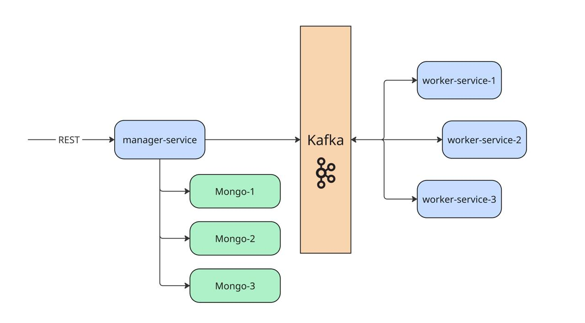

# CrackHash Manager

Сервис-оркестратор распределённого подбора хешей. Принимает запросы на взлом хешей от клиентов через REST API, распределяет задачи между воркерами, собирает и агрегирует результаты.

## Схема сервиса



## Как это работает

1. Клиент отправляет POST-запрос с хешем и максимальной длиной пароля.
2. Менеджер разбивает пространство перебора на равные части и раздаёт их воркерам.
3. Каждый воркер перебирает свой диапазон паролей из заданного алфавита.
4. Менеджер собирает ответы воркеров и возвращает найденные совпадения клиенту.

---

## Режимы работы

Сервис поддерживает два режима передачи задач воркерам, переключаемых через переменную окружения `SEND_TYPE`.

### REST-режим (`SEND_TYPE=rest`)

- Задачи отправляются воркерам по HTTP.
- Состояние задач хранится в памяти (теряется при перезапуске).
- Подходит для разработки и тестирования.

### Kafka-режим (`SEND_TYPE=kafka`)

- Задачи отправляются через Kafka-топик.
- Состояние задач персистентно хранится в MongoDB (набор реплик из 3 узлов).
- Устойчив к перезапускам.
- Рекомендуется для production-окружения.

### Переключение режима

Установить переменную окружения перед запуском:

```bash
# REST-режим (по умолчанию)
SEND_TYPE=rest

# Kafka-режим
SEND_TYPE=kafka
```

В `docker-compose.yml` переменная задаётся в секции `environment` сервиса `crackhash-manager-service`:

```yaml
environment:
  SEND_TYPE: kafka   # или rest
```

---

## Конфигурация

### Переменные окружения

| Переменная       | По умолчанию            | Описание                                 |
|------------------|-------------------------|------------------------------------------|
| `SEND_TYPE`      | `rest`                  | Режим отправки задач: `rest` или `kafka` |
| `CLUSTER_INFO_PATH` | `./clusterInfo.yaml` | Путь к внешнему YAML со списком воркеров |
| `KAFKA_URL`      | `localhost:9092`        | Адрес Kafka-брокера                      |
| `MONGO_DB_HOST`  | `localhost`             | Хост MongoDB                             |
| `MONGO_DB_PORT`  | `27017`                 | Порт MongoDB                             |

### Параметры в `application.yaml`

```yaml
server:
  port: 8085                          # Порт сервиса

send-type: ${SEND_TYPE:rest}          # Режим отправки задач

crack-hash:
  task:
    in_process_lifetime-duration-threshold: PT5S   # Таймаут IN_PROGRESS → FAILED
    half_ready_lifetime-duration-threshold: PT10S  # Таймаут HALF_READY → FAILED

  kafka:
    producer:
      config:
        bootstrap-servers: ${KAFKA_URL:localhost:9092}
        acks: all
        retries: 0
      topic: crackhash_task_request_topic
    consumer:
      config:
        bootstrap-servers: ${KAFKA_URL:localhost:9092}
        group-id: crackhash_task_result_group_id
        auto-offset-reset: earliest
      topic: crackhash_task_result_topic

spring:
  config:
    import: "file:${CLUSTER_INFO_PATH:./clusterInfo.yaml}"
  mongodb:
    host: ${MONGO_DB_HOST:localhost}
    port: ${MONGO_DB_POST:27017}
    database: crackhash_db_mongo
    username: mongo_user
    password: mongo_password
    authentication-database: admin
```

### Внешний список воркеров

Файл `clusterInfo.yaml` хранится вне JAR и Docker-образа:

```yaml
cluster:
  workers:
    worker-1:
      url: http://localhost:8086
    "42":
      url: http://localhost:8087
```

Spring Boot импортирует файл через `spring.config.import` и связывает `cluster.workers`
с `Map<String, WorkerConfig>` в `ClusterProperties`. Ключ — строковое имя или ID,
значение — расширяемый класс `WorkerConfig` с полем `url`. Число частей задачи
вычисляется по размеру мапы и в REST-, и в Kafka-режиме. В Kafka URL не используется
для отправки: задачи по-прежнему передаются через топик.

Используйте простые ID из букв, цифр и дефисов; числовые ID заключайте в кавычки.
Для ключей со специальными символами используйте синтаксис Spring, например `"[worker/east]"`.
Файл обязателен: отсутствие файла, пустая мапа или пустой URL останавливают запуск.
`WORKER_NUMBER` и `WORKER_URL_*` больше не используются.

Путь задаётся без префикса `file:`. Относительный путь считается от рабочего каталога процесса.
Пример запуска в PowerShell:

```powershell
$env:CLUSTER_INFO_PATH = 'C:/configs/clusterInfo.yaml'
java -jar build/libs/manager-service-0.0.1-SNAPSHOT.jar
```

Для Docker Compose используется `config/docker/clusterInfo.yaml`, каталог монтируется
только для чтения в `/etc/crackhash`, а `CLUSTER_INFO_PATH` задан в `environment`.
После изменения файла выполните `docker compose restart crackhash-manager-service`.
При первом переходе на новую конфигурацию пересоздайте контейнер через `docker compose up -d --build`.

### Хранение в Kubernetes

Храните конфиги окружений в Git рядом с манифестами развёртывания (при необходимости
в отдельном инфраструктурном репозитории). В кластере создавайте из файла ConfigMap
и монтируйте её как каталог. В URL указывайте стабильные DNS-имена Service воркеров,
а не IP Pod. Конфигурация не включается в образ приложения.

Создать или обновить ConfigMap из подготовленного для Kubernetes файла:

```bash
kubectl create configmap crackhash-cluster --from-file=clusterInfo.yaml=./clusterInfo.yaml --dry-run=client -o yaml | kubectl apply -f -
```

Фрагмент Deployment (добавьте к остальным настройкам контейнера менеджера):

```yaml
spec:
  template:
    spec:
      containers:
        - name: crackhash-manager
          env:
            - name: CLUSTER_INFO_PATH
              value: /etc/crackhash/clusterInfo.yaml
          volumeMounts:
            - name: cluster-info
              mountPath: /etc/crackhash
              readOnly: true
      volumes:
        - name: cluster-info
          configMap:
            name: crackhash-cluster
```

После обновления ConfigMap перезапустите Deployment (подставьте его имя и namespace):

```bash
kubectl rollout restart deployment/crackhash-manager
kubectl rollout status deployment/crackhash-manager
```

Spring читает конфиг при старте: новые Pod получат актуальный файл без пересборки JAR
и образа. Изменение только ConfigMap не запускает rollout; повторный `apply` неизменного
Deployment тоже не перезапустит Pod. Для автоматизации можно менять checksum-аннотацию
в `spec.template.metadata.annotations` средствами Helm при изменении конфига.
Горячее перечитывание в работающем приложении не предусмотрено.

Документация: [внешняя конфигурация Spring Boot](https://docs.spring.io/spring-boot/reference/features/external-config.html),
[обновление ConfigMap](https://kubernetes.io/docs/tutorials/configuration/updating-configuration-via-a-configmap/).

### Алфавит

Алфавит для перебора паролей задан в классе `AlphabetConfig`:

```java
// src/main/java/ru/nsu/crackhash/manager/config/alphabet/AlphabetConfig.java
private final List<String> alphabet = List.of("r", "i", "s", "e", "m", "1", "2");
```

Для изменения алфавита — отредактируйте этот список и пересоберите сервис.

---

## REST API

Базовый путь: `/api/hash`

### POST `/api/hash/crack` — запустить взлом хеша

**Тело запроса:**
```json
{
  "hash": "5d41402abc4b2a76b9719d911017c592",
  "maxLength": 5
}
```

**Ответ:**
```json
{
  "requestId": "550e8400-e29b-41d4-a716-446655440000"
}
```

---

### GET `/api/hash/request/status?requestId={uuid}` — статус задачи

**Ответ:**
```json
{
  "crackingHashTaskStatus": "READY",
  "answers": ["hello"]
}
```

**Возможные статусы задачи:**

| Статус        | Описание                                              |
|---------------|-------------------------------------------------------|
| `WAITING`     | Задача в очереди, ещё не распределена                 |
| `IN_PROGRESS` | Задача распределена по воркерам, ожидаются ответы     |
| `HALF_READY`  | Часть воркеров ответила                               |
| `READY`       | Все воркеры ответили, результаты готовы               |
| `FAILED`      | Задача превысила таймаут и помечена как упавшая       |

---

### POST `/api/hash/task/result` — получить результат от воркера (внутренний, только для REST-режима)

**Тело запроса:**
```json
{
  "taskId": "550e8400-e29b-41d4-a716-446655440000",
  "answers": ["hello", "world"]
}
```

---

## Запуск

### Требования

- Docker и Docker Compose
- Или Java 21 + Gradle (для локального запуска без Docker)

### Предварительная настройка: создание Docker-сети

Перед первым запуском необходимо создать общую сеть:

```bash
docker network create crackhash-net
```

### 1. REST-режим (только менеджер + воркеры)

Убедитесь, что в `docker-compose.yml` задан `SEND_TYPE=rest`, затем:

```bash
docker-compose up --build
```

Сервис будет доступен на `http://localhost:8085`.

### 2. Kafka-режим (менеджер + MongoDB + Kafka)

```bash
# Запустить MongoDB replica set + менеджер
docker-compose -f docker-compose-mongo.yml -f docker-compose.yml up --build
```

> Перед первым запуском MongoDB replication set нужно инициализировать вручную. Подключитесь к `mongo-1` и выполните:
> ```js
> rs.initiate({
>   _id: "rs0",
>   members: [
>     { _id: 0, host: "mongo-1:27017" },
>     { _id: 1, host: "mongo-2:27017" },
>     { _id: 2, host: "mongo-3:27017" }
>   ]
> })
> ```

### 3. Локальный запуск без Docker

```bash
# Сборка
./gradlew bootJar

# Запуск в REST-режиме
java -jar build/libs/*.jar

# Запуск в Kafka-режиме с кастомными параметрами
SEND_TYPE=kafka KAFKA_URL=localhost:9092 MONGO_DB_HOST=localhost java -jar build/libs/*.jar
```

---

## Технический стек

| Компонент       | Версия / Описание                    |
|-----------------|--------------------------------------|
| Java            | 21                                   |
| Spring Boot     | 4.0.2                                |
| Spring Kafka    | —                                    |
| Spring Data MongoDB | —                               |
| Gradle          | 9.0.0                                |
| MongoDB         | 8.0 (replica set rs0, 3 узла)        |
| Kafka           | confluent 7.9.0                      |
| Docker base     | eclipse-temurin:21-jre               |
